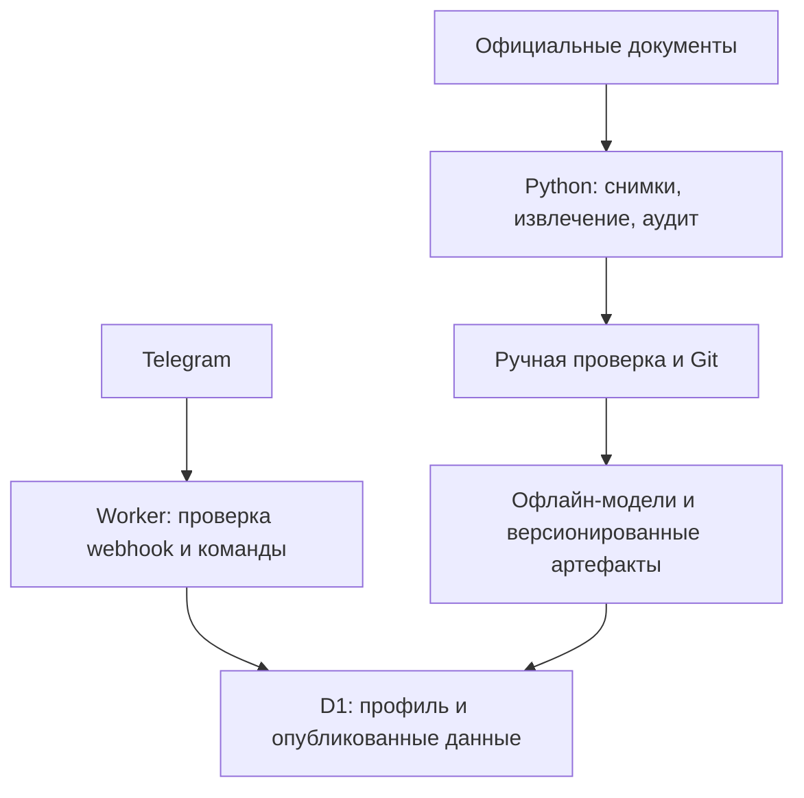

# Архитектура

## Актуализация 1B — 24.10.2026

Сохраняется существующий стек и Worker; никаких новых пользовательских функций на 1B.
`pipeline/mephi_pipeline.py` повторно извлекает факты из снимков и валидирует их.
`pipeline/competition_research.py` добавляет журнал доказательств и оценок соответствий.
Миграция 0005 добавляет `competition_group_assessments` и `historical_group_assessments`:
статусы `confirmed`, `inferred`, `unresolved`, запрет изменения истории, проверки
кампании и недопустимости повышения статуса по одной области мест.
Старый `competition_groups.resolution_status=candidate` сохранён для совместимости;
авторитетная оценка 1B для таких строк — `unresolved` в отдельном журнале.

Вуз, кампус, программа, направление, группа, кампания и категория остаются разными
сущностями. Одна общая ячейка мест не доказывает один конкурс.
В 1B неизвестные соответствия не заменяются синтетическими данными.

D1 хранит нормализованные данные и небольшие доказательные фрагменты; тяжёлые
снимки и будущие ML-расчёты обрабатываются Python вне webhook.
До публичного запуска требуется правовая проверка хранения профилей; существующий
HMAC-профиль используется пока только в локальных синтетических проверках.
План и состояние: [ROADMAP](ROADMAP.md), [PROJECT_STATE](PROJECT_STATE.md).
Описание этапа 0 ниже сохранено как контекст исходной архитектуры.

## Потоки

На этапе 0 реализован Worker и подготовлена D1. Офлайн-извлечение и модели — будущие модули.
Текущий Python-код валидирует заготовки и генерирует отчёт без сетевых запросов.

## Границы модулей

| Модуль | Сейчас | Позже |
| --- | --- | --- |
| `src/index.ts` | HTTP, защита, команды и честные ответы о статусе | Диалоги структурированного ввода |
| `src/store.ts` | Атомарная запись профиля/удаление и receipt | Репозитории остальных сущностей |
| `src/privacy.ts` | HMAC ID и сравнение секрета | Версионирование ключей при ротации |
| `src/domain.ts` | Контракты распределений и простой детерминированный подсчёт по переданным правилам | Проверенные правила вузов, права олимпиад |
| `pipeline/validate.py` | Базовые семантические проверки | Полные контракты каждого адаптера |
| `pipeline/adapters.py` | Protocol и результаты извлечения | Реальные HTML/PDF-адаптеры |
| `pipeline/audit.py` | Детерминированный отчёт пустого каталога | Покрытие программ/лет, пригодность к моделированию |
| `config/` | Область каталога и отключённые предположения | Проверенные параметры и критерии публикации |

Ни сбор сайтов, ни PDF-разбор, ни Monte Carlo не выполняются в webhook.
Будущая модель прогресса возвращает отдельное распределение 0–100 для каждого предмета.
Цель пользователя влияет только на анализ необходимого прироста. Предположения о росте
в `progress.assumptions.json` вымышлены, не обучены и не используются Worker.

## Будущее объединение прогнозов

Для каждого сценария: P(зачисление) = сумма по возможным наборам экзаменов
P(набор будущих баллов) × P(зачисление при рассчитанном конкурсном балле).
Конкурсный балл считает отдельный проверенный модуль правил программы и года.
ДВИ и альтернативные экзамены — самостоятельные компоненты. Прогресс предметов
не следует автоматически считать независимым. Квоты, БВИ, гранты и платный конкурс
имеют отдельные модели и проверки допустимости, без общей смешанной вероятности.

Предыдущий проходной — исторический ориентир, а не оценённая вероятность.
При нехватке истории публикуется `insufficient_data`; сценарные доли не называют
калиброванными вероятностями без проверки на независимых данных.

## Повторная доставка и ограничения

Receipt и изменение профиля записываются одной транзакцией D1 batch.
Повтор receipt не повторяет изменение; исходные сообщения не хранятся.
Ответ отправляется методом `sendMessage` прямо в HTTP-ответе webhook. Telegram не
возвращает результат выполнения этого метода. Возможен повтор текстового ответа;
гарантия exactly-once доставки сообщений не заявляется.

Receipt истекает через 7 суток. Cron ежедневно удаляет максимум 1000 истёкших записей:
это ограничение работы за один запуск, а не гарантия жёсткого срока очистки при большой нагрузке.
После удаления receipt очень поздняя доставка команды снова может изменить состояние.
Для масштабирования нужны дополнительная очистка и формальная политика ретенции.

Текущий `/health` проверяет только доступность процесса и явно сообщает
`databaseChecked: false`. Проверка существования схемы и реальные Telegram-вызовы
проводятся отдельно при развёртывании.

## Годовой расчёт 2A

pipeline.academic_rules → компактные структурные выдержки → dataset/public_rules.json.
academic_rule_versions хранит неизменяемые правила направления/кампуса/года/категории,
не создавая фиктивных конкурсных групп. src/academic.ts считает школьный ЕГЭ и условные
ИД. Области без годовых документов закрываются статусом insufficient_data/manual_review.

## Сценарный расчёт 2B

src/growth.ts — чистый детерминированный расчёт без сетевых запросов и записи профилей.
Явная дата расчёта нужна для воспроизводимости. Config задаёт гипотезы и зависимость
предметов. Семь узлов и кусочная интеграция позволяют лёгкий расчёт в Worker;
массовые симуляции и обучение остаются Python-процессами вне Worker.

## Исторический baseline 3A

pipeline.threshold_baseline отбирает точечные сопоставляемые по текстовому ключу
наблюдения, оценивает только прошлые годы и сохраняет dataset/config/code SHA-256.
Worker читает компактный артефакт. Регистрация как admission_curve запрещена:
baseline предсказывает опубликованную статистику, а не вероятность поступления.

## Офлайн конкурс 3B

models/competition.py не импортируется Worker. В памяти создаются только синтетические
агенты без реальных идентификаторов. Артефакт содержит seed, config/code SHA и явный
запрет deployable=false. Отчёт pipeline.model_readiness привязывает блокировку к
текущим доказательствам источников; историческая MAE не считается калибровкой поступления.

## Интерфейс 4

ReplyKeyboard + ForceReply работают через прежний sendMessage, без callback endpoint
и хранилища сессий. src/ui.ts принимает reply-контекст только от установленного имени
бота и точного текста подсказки. Public catalog index дополнен уже извлечёнными местами
и URL; новые факты не добавлены. Короткие коды проверяются на уникальность тестом.

## Пошаговый интерфейс 4A

src/guided.ts — детерминированный автомат навигации без БД: компактный валидируемый
снимок выбора в callback_data, до 64 ASCII-байт, и читаемая сводка в числовом
ForceReply. Reply принимается только на каноническую подсказку собственного бота.
Private chat/sender/bot/message identity проверяются до обработки callback.
Telegram-сообщения не считаются анонимными данными или решением локализации.

Worker возвращает sendMessage/editMessageText/answerCallbackQuery, Python bridge
выполняет разрешённый метод и отдельный callback ack. В будущем прямом Cloudflare
webhook потребуется проверить такой же ack; текущий транспорт — только локальный.
Рекомендательный интерфейс отделён от допуска вероятностного артефакта. Документированные
минимумы направления МИФИ показываются как справка, не как подтверждение профиля/БВИ.
