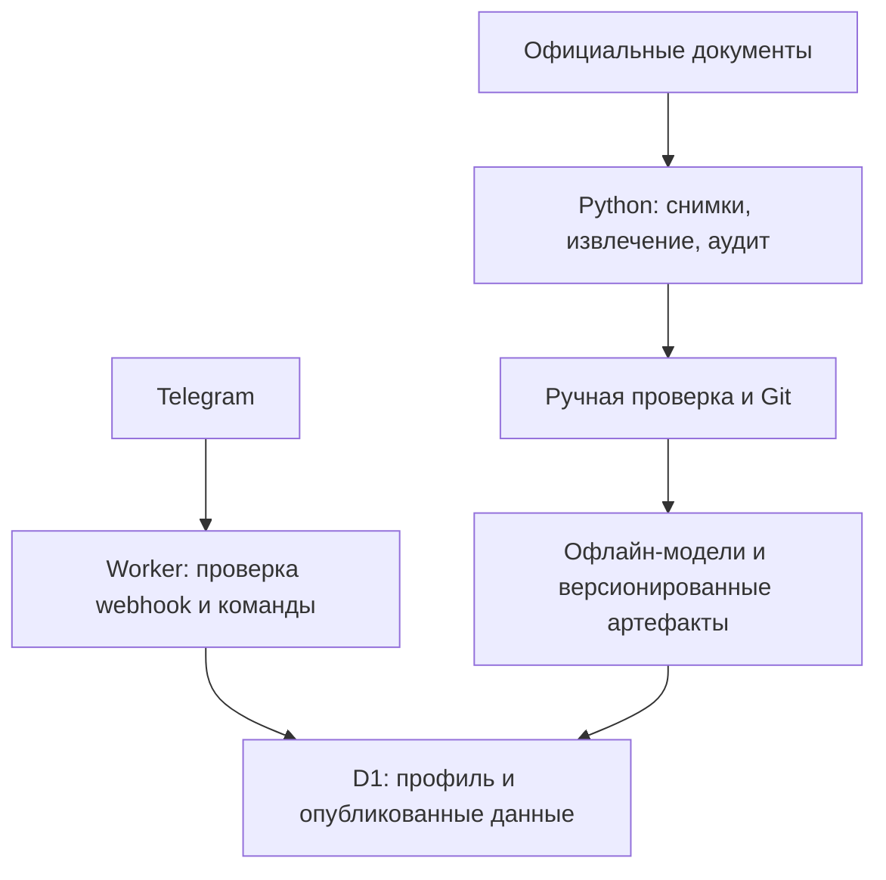

# Архитектура

## Потоки

На этапе 0 реализован Worker и подготовлена D1. Офлайн-извлечение и модели — будущие модули.
Текущий Python-код валидирует заготовки и генерирует отчёт без сетевых запросов.

## Границы модулей

| Модуль | Сейчас | Позже |
| --- | --- | --- |
| `src/index.ts` | HTTP, защита, команды и честные ответы о статусе | Диалоги структурированного ввода |
| `src/store.ts` | Атомарная запись профиля/удаление и receipt | Репозитории остальных сущностей |
| `src/privacy.ts` | HMAC ID и сравнение секрета | Версионирование ключей при ротации |
| `src/domain.ts` | Контракты распределений и простой детерминированный подсчёт по переданным правилам | Проверенные правила вузов, права олимпиад |
| `pipeline/validate.py` | Базовые семантические проверки | Полные контракты каждого адаптера |
| `pipeline/adapters.py` | Protocol и результаты извлечения | Реальные HTML/PDF-адаптеры |
| `pipeline/audit.py` | Детерминированный отчёт пустого каталога | Покрытие программ/лет, пригодность к моделированию |
| `config/` | Область каталога и отключённые предположения | Проверенные параметры и критерии публикации |

Ни сбор сайтов, ни PDF-разбор, ни Monte Carlo не выполняются в webhook.
Будущая модель прогресса возвращает отдельное распределение 0–100 для каждого предмета.
Цель пользователя влияет только на анализ необходимого прироста. Предположения о росте
в `progress.assumptions.json` вымышлены, не обучены и не используются Worker.

## Будущее объединение прогнозов

Для каждого сценария: P(зачисление) = сумма по возможным наборам экзаменов
P(набор будущих баллов) × P(зачисление при рассчитанном конкурсном балле).
Конкурсный балл считает отдельный проверенный модуль правил программы и года.
ДВИ и альтернативные экзамены — самостоятельные компоненты. Прогресс предметов
не следует автоматически считать независимым. Квоты, БВИ, гранты и платный конкурс
имеют отдельные модели и проверки допустимости, без общей смешанной вероятности.

Предыдущий проходной — исторический ориентир, а не оценённая вероятность.
При нехватке истории публикуется `insufficient_data`; сценарные доли не называют
калиброванными вероятностями без проверки на независимых данных.

## Повторная доставка и ограничения

Receipt и изменение профиля записываются одной транзакцией D1 batch.
Повтор receipt не повторяет изменение; исходные сообщения не хранятся.
Ответ отправляется методом `sendMessage` прямо в HTTP-ответе webhook. Telegram не
возвращает результат выполнения этого метода. Возможен повтор текстового ответа;
гарантия exactly-once доставки сообщений не заявляется.

Receipt истекает через 7 суток. Cron ежедневно удаляет максимум 1000 истёкших записей:
это ограничение работы за один запуск, а не гарантия жёсткого срока очистки при большой нагрузке.
После удаления receipt очень поздняя доставка команды снова может изменить состояние.
Для масштабирования нужны дополнительная очистка и формальная политика ретенции.

Текущий `/health` проверяет только доступность процесса и явно сообщает
`databaseChecked: false`. Проверка существования схемы и реальные Telegram-вызовы
проводятся отдельно при развёртывании.
